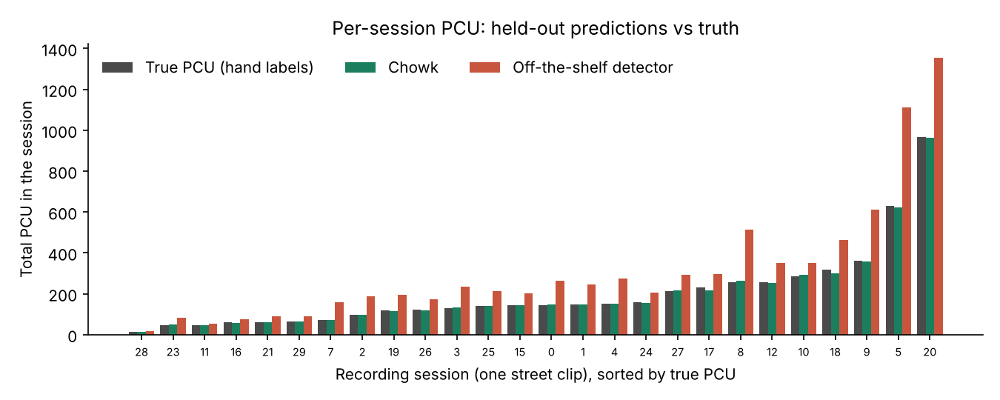
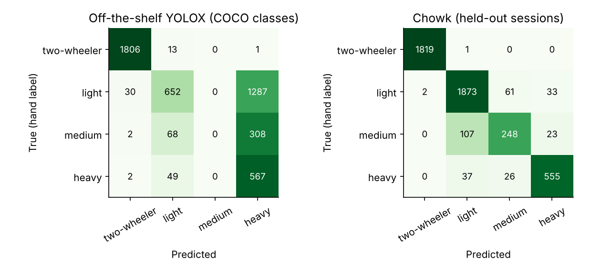
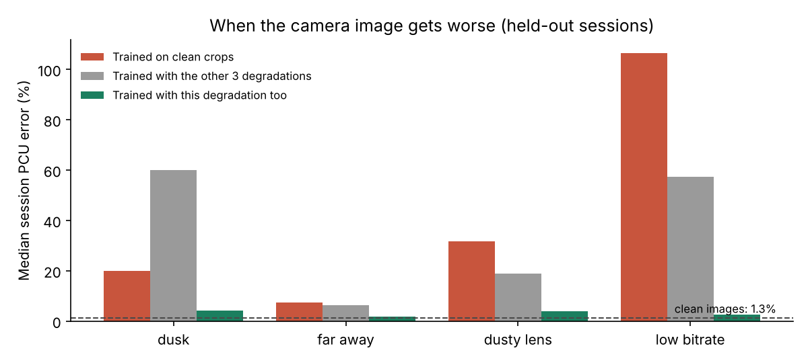
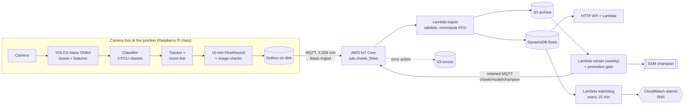

# Chowk (चोक): vehicle-mix traffic counts for Kathmandu junctions

[](https://chowk-kathmandu-traffic.onrender.com)

Chowk counts the traffic through a Kathmandu junction by vehicle type and turns it into **Passenger Car Units (PCU)**, the unit traffic engineers use for signal timing and road capacity. A small model runs on a camera box at the junction; only a few hundred bytes of counts leave it every 15 minutes. It is trained and tested on real crops from 30 Kathmandu street videos, and the cloud side is designed for AWS at about **$5.70 a month for 20 junctions**.

```text
{"junction": "replay", "approach": "recorded_clips", "interval_start": "2016-06-01T08:15:00",
 "counts": {"two_wheeler": 72, "light": 64, "medium": 12, "heavy": 10},
 "pcu": 148.0, "pcu_per_hour": 592.0, "minutes_observed": 15, ...}

Hand-labelled truth for the same clip: 72 / 60 / 17 / 9 vehicles = 148.5 PCU.
```
*(Real held-out output: one recorded session run through the counting code, with a model that never saw that session.)*

## The problem

Kathmandu's junctions (Maitighar, Kalanki, Koteshwor, Chabahil) are run by traffic police with hand signals and fixed-time lights. Signal timing and road widening are planned from manual counts: a few people with clickers on a few days a year. The mix is what makes it hard. More than half of what moves is motorcycles and scooters, then cars and taxis, then microbuses and tempos (the city's main public transport), then buses and trucks. A bus takes the road space of six motorcycles, so a raw vehicle count says little about how close a junction is to jamming. Nepal's road standard says it in PCU: two-wheeler 0.5, car 1.0, microbus 1.5 (my reading, see below), bus or truck 3.0.

A camera can count around the clock, but the obvious approach, an off-the-shelf detector, gets Kathmandu's traffic wrong in a way that matters. That gap is the project.

## Results

Five-fold cross-validation **grouped by recording session**, so no clip is ever in both training and test. 4,785 vehicles in 31 sessions; PCU error is per session (26 sessions with at least 20 vehicles).

| | Accuracy | Macro-F1 | Median session PCU error | Worst session | Overall bias |
|---|---:|---:|---:|---:|---:|
| Off-the-shelf YOLOX (COCO classes mapped to PCU) | 63.2% | 0.467 | 45.7% | 116.6% | +54.7% |
| Two classes only (every four-wheeler is a car) | 79.2% | 0.449 | 25.5% | 46.8% | -26.8% |
| **Chowk** (classifier on the detector's own features) | **93.9%** | **0.884** | **1.3%** | **9.0%** | **-0.7%** |

**The off-the-shelf detector overstates Kathmandu's traffic by about half**: it calls 65% of cars and 81% of microbuses "truck" or "bus". Chowk keeps the same detector and adds a 4-class logistic regression on 256 numbers pooled from inside it, trained on 4,785 crops I labelled.





**It keeps working when the image gets worse, if it has been trained for it.** Dusk, a far lane, a dusty lens and a low-bitrate stream, simulated on every crop:



A model trained on clean crops is 20-106% off on bad images. Trained with degraded copies it is 2-4% off, at a cost of 0.6 points on clean images. That's the model that ships. Cheap image checks on the box flag 98-100% of degraded frames, so a bad image shows up as "degraded" in the API instead of as wrong numbers ([docs/FAILURE_MODES.md](docs/FAILURE_MODES.md)).

### What I'd tell an interviewer about these numbers

- **Errors cancel, and that can hide a bad model.** In the example above Chowk got medium wrong by 5 vehicles and still landed within 0.5 PCU, because car-for-microbus and microbus-for-car mistakes go in opposite directions. The off-the-shelf detector at its default score threshold of 0.25 looks decent on PCU (10.6% off) only because it misses 30-43% of vehicles *and* calls the rest trucks. Its accuracy is 43%. I report accuracy and per-class F1 next to PCU error for this reason.
- **The microbus weight is my assumption.** The standard doesn't list a microbus; I put it with light trucks at 1.5. At 1.0 or 3.0 Chowk is 1.4% and 3.4% off, and the off-the-shelf detector 51% and 34%. The conclusion doesn't depend on it.
- **These are crops, not junction frames.** Every test vehicle was found and cut out by a person. Detector recall in dense traffic, occlusion, and the tracker's double counts are not measured. The first deployment step is an hour of real junction video counted by hand.
- **A random split would have flattered me**, mostly in the worst case (5.6% instead of 9.0%), because consecutive frames of the same vehicle end up on both sides.
- **Augmentation fixes what it has seen.** Trained on three degradations and tested on the fourth, dusk got *worse* (60% off). Rain and night are untested, so I treat them as broken.

## Architecture



**The model runs on the box, not in the cloud**, because a junction camera produces about 324 GB of video a month and Nepali 4G can't carry it. Streaming video to Rekognition would cost about $4,300 per camera per month; a SageMaker endpoint about $36. Counts are 0.6 GB. AWS IoT Core gives each box its own certificate and an offline-tolerant MQTT link; S3 is the source of truth and DynamoDB a rebuildable query cache. Full diagram and reasoning: **[docs/ARCHITECTURE.md](docs/ARCHITECTURE.md)**.

## Engineering documents

| Document | What's in it |
|---|---|
| [Architecture](docs/ARCHITECTURE.md) | Edge and cloud diagrams, data flow, why each component exists, how it scales at 10x and 100x, what's missing to go live |
| [Alternatives considered](docs/ALTERNATIVES.md) | 8 decision records: which traffic problem, fine-tune vs classify on features, PCU classes and the microbus, edge vs cloud inference, Lambda vs SageMaker, IoT Core vs API Gateway, DynamoDB + S3, IaC |
| [What breaks](docs/FAILURE_MODES.md) | 15 failure modes with detection and response, and a **measured** image-degradation experiment |
| [Cost](docs/COST.md) | Itemised monthly cost for 1, 20 and 200 junctions, the edge hardware, and the video-streaming designs I didn't build |
| [Challenges and bugs](docs/CHALLENGES_AND_BUGS.md) | 15 real problems hit while building this, with evidence and fixes |
| [Model card](docs/MODEL_CARD.md) | Intended use, evaluation, limitations, and who the errors affect |

## How it maps to the AWS Well-Architected pillars

| Pillar | In this project |
|---|---|
| Operational excellence | Everything in IaC (SAM, cfn-lint in CI); structured EMF metrics; alarms on *freshness* (a camera or the watchdog going quiet), not only on errors; every record carries its model version; one-parameter rollback |
| Security | One X.509 certificate per box; IoT policy pins each box to its own topic and S3 prefix; ingest checks the box may report for that junction and recomputes PCU instead of trusting it; S3 encrypted, public access blocked; video never leaves the box |
| Reliability | On-disk outbox and idempotent ingest survive 4G outages; partial intervals are labelled, not hidden; IoT rule error action to S3; DLQ on schedules; promotion gate on retraining |
| Performance efficiency | Inference at the edge (24 ms per 720p frame on one CPU core); features reused from the detector, so the classifier adds microseconds; DynamoDB key design matches the only two queries |
| Cost optimisation | Basic Ingest (no messaging charge); container Lambdas on Graviton; on-demand DynamoDB; HTTP API; S3 lifecycle; budget alarm. $5.66/month for 20 junctions |
| Sustainability | No video upload, no GPU, no always-on endpoint; a 0.9M-parameter detector and a logistic regression |

## Try it live

**[https://chowk-kathmandu-traffic.onrender.com](https://chowk-kathmandu-traffic.onrender.com)**

Upload a photo of a vehicle (or pick a crop from the dataset) and see its PCU class next to what an off-the-shelf detector says, then browse every recorded session as 15-minute flows.

It runs on a free server that sleeps when nobody is using it, so the first visit can take a minute to wake up. Everything runs offline: no API keys, no cloud account.

To run the same page locally: `pip install -r requirements-app.txt` and then `streamlit run app.py`.

## Run it

**With Python 3.12+:**

```bash
make setup && source .venv/bin/activate
make quality      # download the dataset and detector (checksummed); data-quality report
make evaluate     # grouped CV, baselines, charts in docs/img (about 5 minutes)
make robustness   # dusk / far away / dusty lens / low bitrate (about 10 minutes)
make train        # train with the promotion gate -> artifacts/models/champion
make replay       # run every recorded session through the counting code as 15-minute flows
make serve        # API on http://localhost:8000  (try /junctions and /docs)
make test         # 49 tests, including the camera loop and the Lambda handlers on mocked AWS
make cost         # monthly AWS cost for 1, 20 and 200 junctions
```

**With Docker:** `docker build -t chowk . && docker run --rm -p 8000:8000 chowk`

**On AWS:** see [infra/README.md](infra/README.md) (`sam build && sam deploy --guided`, a seed script, and one command per camera box). Not deployed: this is the design and its tested code.

## Repository layout

```text
chowk/
  data.py         download (pinned + checksummed), recover recording sessions, duplicates, quality report
  detector.py     YOLOX-Nano on ONNX Runtime: boxes, and features pooled from inside the network
  features.py     feature cache for the labelled crops
  model.py        the classifier, its metadata, low-confidence review queue
  evaluate.py     grouped CV, baselines, PCU error, robustness and image-check experiments
  counting.py     tracker, count line, 15-minute FlowRecord, volume-to-capacity
  quality.py      cheap image checks: dark, low contrast, blurry, compressed
  edge.py         the camera-box loop and its on-disk outbox
  pipeline.py     training with the promotion gate; session replay
  store.py        LocalStore and DynamoStore behind one interface
  status.py       what the API says about an approach (partial, degraded, level)
  api.py          FastAPI (local); same routes on Lambda in aws/handlers.py
  aws/handlers.py Lambda entry points: ingest, watchdog, retrain, api
data/             hand labels (CSV), junction geometry, dataset notes
infra/            SAM template, Lambda Dockerfile, deploy guide
scripts/          cost model, AWS seeding, camera registration
tests/            data, detector, evaluation, counting, camera loop, API, Lambda handlers on moto
docs/             the engineering documents above
```

## Data and credits

Vehicle crops: [sdevkota007/vehicles-nepal-dataset](https://github.com/sdevkota007/vehicles-nepal-dataset), cut from 30 Kathmandu street videos in 2016 by its author and project mates Anup Adhikari, Binish Koirala and Sparsha Bhattarai. Downloaded from its own URL, pinned to a commit and verified by SHA-256; not redistributed here. The four-wheeler classes (light, medium, heavy) in [data/labels/vehicle_classes.csv](data/labels/vehicle_classes.csv) are my own labels. See [data/README.md](data/README.md).

Detector: [YOLOX-Nano](https://github.com/Megvii-BaseDetection/YOLOX) (Apache-2.0), ONNX release weights, verified by SHA-256.

PCU factors: Nepal Road Standard 2070, Department of Roads.

## License

MIT for the code and labels. The dataset and detector weights remain under their sources' terms.
