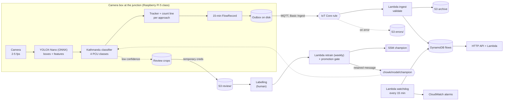

# Architecture

## The whole system

## Why each piece exists

**The detector runs on the box and does two jobs.** YOLOX-Nano is 3.7 MB, Apache-2.0, and runs on a CPU. It finds vehicles well; what it can't do is name Kathmandu's vehicles. So its boxes are kept and its labels are thrown away: two internal feature maps (the 13x13 FPN lateral map and the 26x26 backbone map, 128 channels each) are averaged under each box into a 256-number vector, and a logistic regression trained on Kathmandu vehicles names the class. One forward pass, no second network.

**Counting needs a tracker.** A vehicle is visible in 10-30 frames. The tracker (greedy IoU matching, which is enough at 2-5 fps where vehicles move a fraction of a box per frame) follows it, and when its centre crosses an approach's count line it is counted once with the class it was given most often. Majority voting over a track also smooths over single-frame mistakes.

**Only counts leave the box.** Every 15 minutes, one record per approach: counts per class, PCU, PCU/hour and how many minutes the camera actually saw. It goes to a file in the outbox first and is deleted only after the broker acknowledges it, so an outage delays data instead of losing it.

**The cloud side is small on purpose.** IoT Core authenticates each box by certificate. Basic Ingest sends the message straight to a rule (no broker fan-out, no messaging charge). The ingest Lambda re-validates everything: it recomputes PCU from the counts instead of trusting the box, rejects timestamps in the future and off the 15-minute grid, and archives to S3 before writing DynamoDB. The DynamoDB key `junction#approach` + `interval_start` makes a re-sent record overwrite itself.

**A watchdog looks for silence.** Errors are easy to alarm on; a camera that simply stops is not, because nothing fails. Every 15 minutes the watchdog checks each approach's latest record and emits `StaleApproaches`. The alarm on it treats missing data as breaching, so the watchdog itself stopping also fires it.

## The labelling loop

The model's weak spot is the boundary between light vans and microbuses (README, "What I'd tell an interviewer"). The way to improve it is more labels exactly there. When the classifier's top probability is below 0.55, the box saves the crop and its feature vector (at most five per interval, 2.5% of vehicles) and uploads them to `s3://bucket/review/<camera>/` with short-lived credentials from the IoT credentials provider. Those are the crops the model is unsure about, and it is wrong on about half of them, so each label is worth far more than a random one.

A person labels them (any tool that writes `image,label` rows; the repo's labels are a CSV). The weekly retrain picks up the new labels, runs session-grouped cross-validation, and only promotes the model if it is no worse than the champion. Promotion writes the version to SSM and publishes a retained MQTT message, which each box picks up the next time it connects.

Review crops can show faces and number plates, so the bucket expires them after 90 days and the IAM role only lets a box write under its own prefix.

## Local versus AWS

| Step | Locally | On AWS |
|---|---|---|
| Detector + classifier + counting | `chowk.edge.CameraBox` in a Python process | same code on the camera box |
| Transport | none | MQTT to IoT Core, Basic Ingest |
| Storage | `artifacts/flows.jsonl` (`LocalStore`) | DynamoDB (`DynamoStore`) + S3 |
| API | FastAPI, `python -m chowk serve` | HTTP API + Lambda (`api_handler`, no FastAPI) |
| Retrain | `python -m chowk train` | weekly Lambda, same `train_with_gate` |

The store interface is the same in both, which is why the API code and the tests don't care where they run.

## Scaling

**10x (200 junctions, 800 approaches).** About 77,000 records a day. One Lambda invocation per record is fine (a few concurrent executions). The cost that grows fastest is S3 PUTs for the per-record archive, about $28/month, which becomes the largest line item (docs/COST.md). Fix: send the archive through Kinesis Data Firehose, which writes one object per few minutes instead of one per record.

**100x.** The cloud side still scales by itself; the hard parts move to the edge: provisioning 2,000 boxes (IoT fleet provisioning by claim instead of a script per box), updating their software (Greengrass components instead of a hand-rolled updater), and the labelling queue, which at 2.5% of vehicles would be far more than people can label. At that point the review threshold drops and sampling becomes stratified by junction and time of day.

## Going live: what's missing

- **Full-frame validation.** The classifier is measured on crops cut by a person, so detection recall on real junction frames is not measured. The first deployment step is to record an hour at one junction, count it by hand, and compare (docs/MODEL_CARD.md).
- **Per-junction calibration.** Count-line positions and approach geometry come from a site visit. The lane counts and green ratios in `data/junctions.json` are illustrative.
- **Night.** The dataset is daytime only (docs/FAILURE_MODES.md).
